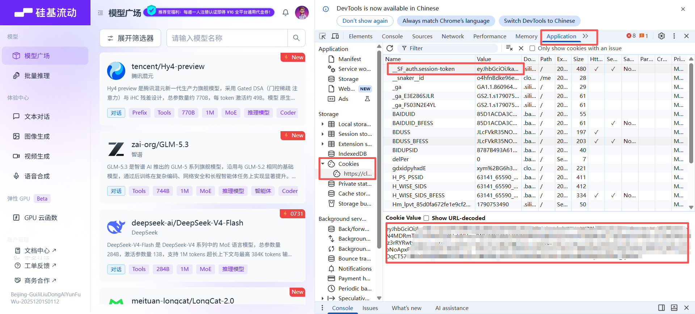
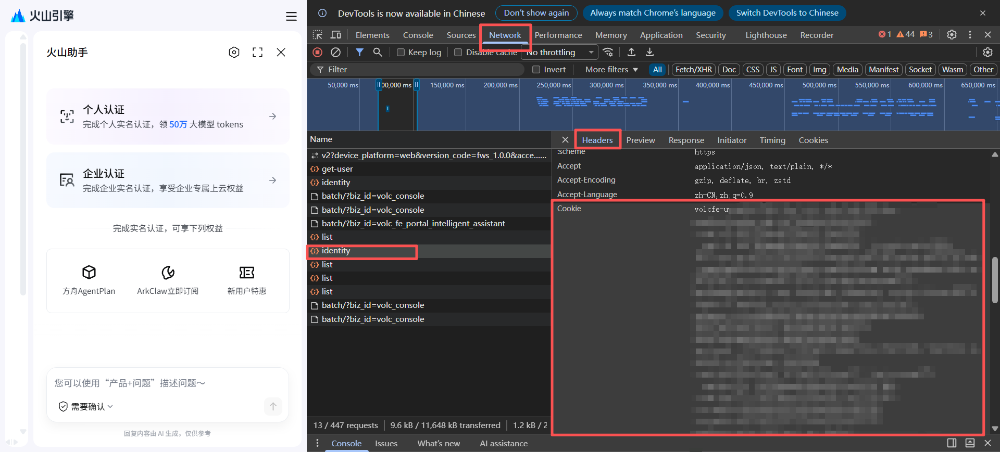

# AI CodingPlan Check

  
  
  
  
  
  

If you subscribe to more than one AI coding service at the same time—or hold more than one account with the same service—you can review the remaining quota of each AI coding plan in an Obsidian side panel, aggregated in one place instead of opening every official web console.

## 1. Supported Services

| Service | Credential | Description |
| --- | --- | --- |
| OpenCode Go | API Key | Shows the 5-hour / 7-day / 30-day USD budget windows and balance |
| Command Code | API Key | The official side only provides 5-hour and weekly usage windows, plus a balance display |
| 火山方舟 Volcengine Ark | AK/SK | Auto-detects both Coding Plan and Agent Plan subscriptions |
| 智谱 GLM Zhipu GLM | API Key | Shows the official 5-hour / daily / weekly windows (varies by plan tier); MCP quota listed separately |
| Kimi For Coding | API Key | Shows the 5-hour and weekly windows |
| MiniMax | Subscription Key | 5-hour and weekly windows of the Token Plan subscription |
| DeepSeek | API Key | Pay-as-you-go balance: top-up / bonus breakdown |
| 硅基流动 SiliconFlow | API Key | Pay-as-you-go balance: top-up / bonus breakdown (the domestic-site balance API has been discontinued by the provider; the international site still works) |
| Moonshot Platform | API Key | Open-platform pay-as-you-go balance: cash / voucher breakdown |
| StepFun | API Key | Pay-as-you-go balance with total top-up / bonus |
| PPIO | API Key | Pay-as-you-go balance: cash / credit |
| SiliconFlow (Cookie) | Console session cookie | Domestic-site balance and voucher details (how to obtain: below) |
| Volcengine Ark (Cookie) | Console session cookie | Query Coding Plan / Agent Plan usage with the console session when creating an AK/SK is inconvenient; complements the AK/SK form (below) |
| Xiaomi MiMo (Cookie) | Console session cookie | Plan usage and pay-as-you-go balance; one cookie yields both cards (below) |

Subscription services display the official usage windows (percent used + reset countdown); balance services display the top-up balance with top-up / voucher breakdowns.

### 1.1 Cookie-based services: obtaining the console cookie

The three services—SiliconFlow (Cookie), Volcengine Ark (Cookie), and Xiaomi MiMo (Cookie)—use the console login session (a session cookie) instead of an API key. They suit services without an open API key, or where the official key-based interface has been discontinued. It takes about half a minute in a desktop browser:

1. Sign in to the relevant console: SiliconFlow [cloud.siliconflow.cn](https://cloud.siliconflow.cn), Volcengine Ark [console.volcengine.com](https://console.volcengine.com), Xiaomi MiMo [platform.xiaomimimo.com](https://platform.xiaomimimo.com).
2. Press `F12` to open the developer tools and grab the cookie for the service:
   - **SiliconFlow**: switch to the **Application** tab, select the site under **Cookies**, find `__SF_auth.session-token`, copy its Value and paste it into the plugin; copying the whole `Cookie:` request header from any request in the **Network** tab also works—the plugin recognizes it automatically.

      
   - **Volcengine Ark / Xiaomi MiMo**: switch to the **Network** tab, refresh the page, click any request, find the `Cookie:` request header under **Headers**, and copy the whole string into the plugin.

      
3. Mobile: on Android, use an extension-capable browser (e.g. Firefox + Cookie-Editor) to grab the value; iOS browsers cannot read it—add the account on desktop first, then use "Credential export" and unlock it on the phone with the passphrase.

Note: a session cookie equals your login state and carries more privilege than an API key—do not share it. When it expires the plugin states it clearly; just copy and paste a fresh one (per community experience, the Volcengine Ark cookie needs re-pasting roughly every 7 days). SiliconFlow accounts must have completed real-name verification.

## 2. Install and Get Started

1. Install and enable **AI CodingPlan Check** from Obsidian settings → third-party plugins.
2. Add an account: settings → **AI CodingPlan Check** → "Add account"; choose the plan source, set an alias, paste the credential, and click "Test and save". The plugin verifies connectivity first and then pulls your plan details automatically.
3. View quotas: click the gauge icon on the left ribbon, or run "Open quota panel" from the command palette; cards are grouped by service, each card can refresh individually, and the toolbar row supports refresh-all, sorting, and expand / collapse.

Requires Obsidian `1.11.4` or later; both desktop and mobile are supported.

## 3. Credentials and Data Safety

- Provider credentials in plaintext are stored only in Obsidian's system secure storage; the plugin data file keeps just account aliases and credential pointers, never plaintext.
- Optional "Credential export": once enabled, each account's credentials are saved as an encrypted copy alongside the plugin data. On another device opening the same vault, the panel restores them on first view after you enter the passphrase; the credential itself stays under system protection and is never copied directly. A device that has not enabled export acts as a receiver: when the encrypted copies change, open the panel, enter the passphrase once, and the local credentials are updated to the exporter's latest copies. The passphrase itself is not stored and never logged; if forgotten, simply export again.
- Network behavior: requests go directly to the official endpoints of each provider only while querying quotas (opening the panel, manual refresh, or connectivity tests when adding an account); no telemetry, no ads, no payments, and no access to your notes or external files. Domains involved: `opencode.ai`, `api.commandcode.ai`, `open.volcengineapi.com` (the cookie form additionally uses `console.volcengine.com`), Zhipu `open.bigmodel.cn` / `api.z.ai`, Kimi `api.kimi.com` / `api.kimi.ai`, MiniMax `www.minimax.cn` / `api.minimaxi.com` / `www.minimax.io` / `api.minimax.io`, DeepSeek `api.deepseek.com`, SiliconFlow `api.siliconflow.cn` / `api.siliconflow.com` (the cookie form additionally uses `account.siliconflow.cn` / `cloud.siliconflow.cn`), Moonshot `api.moonshot.cn` / `api.moonshot.ai`, StepFun `api.stepfun.com`, PPIO `api.ppio.com` / `api.ppinfra.com`, and Xiaomi MiMo (Cookie) `platform.xiaomimimo.com`.

## 4. Known Limitations

- Volcengine Ark quota queries require a self-created AK/SK in the console (a hard requirement of the official control plane; no API-key alternative exists). Use a least-privilege IAM sub-user. If that is inconvenient, the "Volcengine Ark (Cookie)" form queries with the console session instead. Ark's 5-hour window has no official fixed reset time, so no countdown is shown for that tier.
- Command Code's "current period" follows its billing cycle.
- Credential formats differ: Zhipu GLM uses the Coding Plan API key; Kimi uses an API key created in the Kimi Code console (`sk-kimi-…`, not the open-platform key); MiniMax uses the Token Plan Subscription Key (`sk-cp-…`, not interchangeable with pay-as-you-go keys). All three auto-detect between domestic and international sites and use the key's actual home site. The Moonshot platform also uses the open-platform key (`sk-…`), which is not interchangeable with Kimi For Coding's key.
- Zhipu GLM, Kimi For Coding, MiniMax, Moonshot Platform, StepFun, PPIO, and Xiaomi MiMo (Cookie) have not been verified against real accounts yet: the interface behavior comes from official documentation, the quota endpoints used by official plugins / CLI tools, and public test responses. If a query fails, paste the exact on-screen hint into Issues to help locate it.
- Quotas refresh manually; there is no automatic polling.
- A forgotten "export passphrase" cannot decrypt an already-generated encrypted copy (the passphrase is not stored); set a new passphrase and export again.

## 5. License and Support

- Open source under [MIT](LICENSE).
- If a query fails or shows an unusual hint, paste the exact on-screen text into [GitHub Issues](https://github.com/jiaoyingxing/ai-codingplan-check/issues) to help locate it.
- Community and product updates: search Xiaohongshu for **焦应行** 🔍
