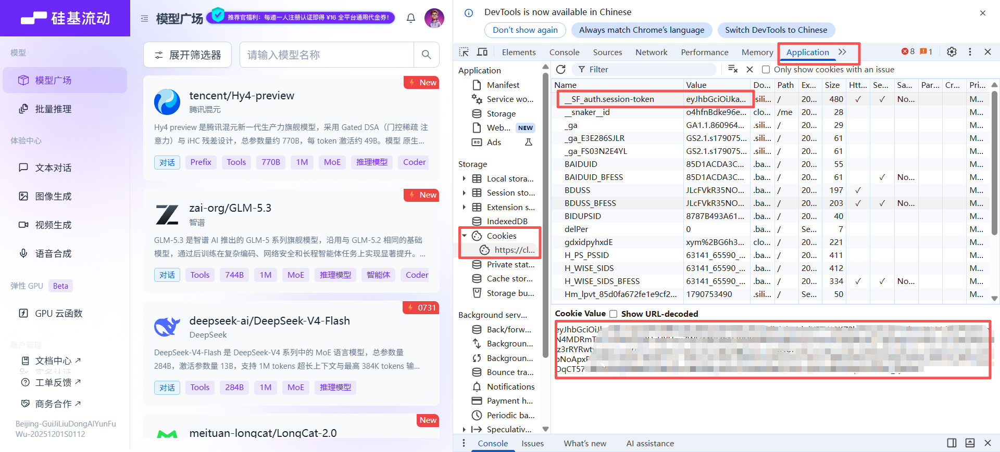
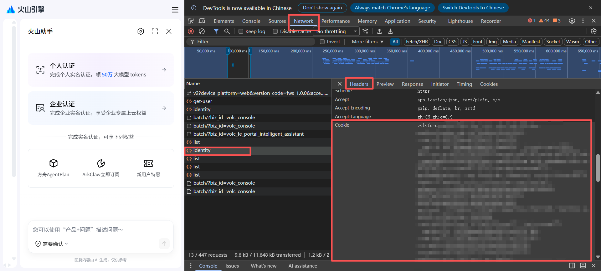

# AI 编程套餐查询（AI CodingPlan Check）

如果你同时订阅了多家 AI 编程服务，或者同一服务挂了不止一个账号，可以在 Obsidian 侧栏里，聚合查看多家 AI 编程订阅套餐的剩余额度，不用挨个开官网控制台。

## 支持的服务

| 服务 | 接入凭证 | 说明 |
| --- | --- | --- |
| OpenCode Go | API Key | 展示 5 小时 / 7 天 / 30 天美元预算窗口与余额 |
| Command Code | API Key | 官方仅提供 5 小时与每周两档用量窗口，另有余额展示 |
| 火山方舟 | AK/SK | Coding Plan 与 Agent Plan 双订阅自动探测 |
| 智谱 GLM | API Key | 展示官方返回的 5 小时 / 日 / 周等窗口（随套餐档位而异），MCP 额度另列为附加信息 |
| Kimi For Coding | API Key | 展示 5 小时与周窗口 |
| MiniMax | Subscription Key | Token Plan 订阅的 5 小时与周窗口 |
| DeepSeek | API Key | 按量余额：充值 / 赠送拆分 |
| 硅基流动 | API Key | 按量余额：充值 / 赠送拆分（国内站余额接口已被官方停用，国际站可用） |
| Moonshot 平台 | API Key | 开放平台按量余额：现金 / 代金券拆分 |
| StepFun | API Key | 按量余额与充值 / 赠送总额 |
| PPIO | API Key | 按量余额：现金 / 信用额度 |
| 硅基流动（Cookie） | 控制台会话 Cookie | 国内站余额与代金券明细（获取方式见下文） |
| 火山方舟（Cookie） | 控制台会话 Cookie | 不便自建 AK/SK 时查 Coding Plan / Agent Plan 用量，与 AK/SK 版互补（获取方式见下文） |
| 小米 MiMo（Cookie） | 控制台会话 Cookie | 套餐用量与按量余额，一张 Cookie 出两类卡（获取方式见下文） |

订阅类服务展示官方用量窗口（已用百分比 + 重置倒计时），余额类服务展示充值余额与赠送 / 代金券等拆分明细。

### Cookie 类服务：控制台 Cookie 的获取

「硅基流动（Cookie）」「火山方舟（Cookie）」「小米 MiMo（Cookie）」三个服务用控制台登录态（会话 Cookie）代替 API Key 查询，适合没有开放 API Key、或官方已停用 Key 查询接口的服务。电脑浏览器上约半分钟：

1. 浏览器登录对应控制台：硅基流动 [cloud.siliconflow.cn](https://cloud.siliconflow.cn)、火山方舟 [console.volcengine.com](https://console.volcengine.com)、小米 MiMo [platform.xiaomimimo.com](https://platform.xiaomimimo.com)。
2. 按 `F12` 打开开发者工具，按服务取 Cookie：
   - **硅基流动**：切到 **Application**（应用）标签，左侧 **Cookies** 里选中站点，找到 `__SF_auth.session-token`，复制它的 Value 粘贴到插件即可；从 **Network** 标签里任意请求的 `Cookie:` 请求头整串复制，插件也能自动识别。

     
   - **火山方舟 / 小米 MiMo**：切到 **Network**（网络）标签，刷新页面后点任意一条请求，在 **Headers**（标头）里找到请求头 `Cookie:`，整串复制粘贴到插件即可。

     
3. 手机端：Android 可用支持扩展的浏览器（如 Firefox + Cookie-Editor）直接取值；iOS 的浏览器读不到该值，建议先在电脑上添加账号，再通过「凭证导出」在手机输入口令解锁使用。

注意：会话 Cookie 等同于你的登录状态，权限大于 API Key，请勿外传；失效后插件会明确提示，重新复制粘贴一次即可（火山方舟的 Cookie 按社区经验约 7 天需重贴）。硅基流动账号需已完成实名。

## 安装与开始

1. 在 Obsidian 设置 → 第三方插件中搜索 **AI CodingPlan Check** 安装并启用。
2. 添加账号：设置 → **AI CodingPlan Check** → 「添加账号」，选套餐来源、起个别名、粘贴凭证，点「测试并保存」，插件会先验证连通并自动拉取套餐信息。
3. 查看额度：点左侧栏 ribbon 的仪表图标，或用命令面板执行「打开额度面板」；卡片按服务分组，每张卡可单独刷新，工具行支持全部刷新、排序与展开收起。

需要 Obsidian 1.11.4 或更高版本；桌面端与移动端均可使用。

## 凭证与数据安全

- 各家凭证明文只保存在 Obsidian 的系统安全存储中；插件数据文件只存账号别名与凭证指针，不存明文。
- 可选「凭证导出」：开启后，各账号凭证会加密成副本随插件数据保存，其他设备打开同一库时，在面板首次查看输入口令即可还原；凭证本体仍受系统安全保护，不会直接复制。口令本身不保存、不进日志，遗忘后重新导出即可。
- 联网行为：仅在查询额度时（打开面板、手动刷新或添加账号验证连通）直连各家服务的官方接口；无遥测、无广告、无支付、不访问你的笔记与外部文件。涉及域名：`opencode.ai`、`api.commandcode.ai`、`open.volcengineapi.com`（Cookie 形态另用 `console.volcengine.com`）、智谱 `open.bigmodel.cn` / `api.z.ai`、Kimi `api.kimi.com` / `api.kimi.ai`、MiniMax `www.minimax.cn` / `api.minimaxi.com` / `www.minimax.io` / `api.minimax.io`、DeepSeek `api.deepseek.com`、硅基流动 `api.siliconflow.cn` / `api.siliconflow.com`（Cookie 形态另用 `account.siliconflow.cn` / `cloud.siliconflow.cn`）、Moonshot `api.moonshot.cn` / `api.moonshot.ai`、StepFun `api.stepfun.com`、PPIO `api.ppio.com` / `api.ppinfra.com`、小米 MiMo（Cookie）`platform.xiaomimimo.com`。

## 已知限制

- 火山方舟的额度查询默认需要在控制台自建 AK/SK（官方控制面硬性要求，API Key 替代路径不存在），建议使用最小权限的 IAM 子用户；不便自建时可用「火山方舟（Cookie）」形态直接用控制台登录态查询。方舟 5 小时窗口官方不提供固定重置时刻，因此不显示该档倒计时。
- Command Code 的「本期」按账单周期计算。
- 智谱 GLM、Kimi For Coding、MiniMax 的凭证口径各不相同：GLM 用 Coding Plan 的 API Key，Kimi 用 Kimi Code 控制台创建的 API Key（`sk-kimi-…`，不是开放平台的 Key），MiniMax 用 Token Plan 的 Subscription Key（`sk-cp-…`，与按量付费的 Key 不通用）；三家都会在国内站与国际站之间自动探测，按 Key 的实际归属站点取值。Moonshot 平台用的也是开放平台 Key（`sk-…`），与 Kimi For Coding 的 Key 不通用。
- 智谱 GLM、Kimi For Coding、MiniMax、Moonshot 平台、StepFun、PPIO、小米 MiMo（Cookie）尚未经真实账号验证：接口口径取自各家官方文档、官方插件 / CLI 使用的额度接口与公开实测响应。如遇查询失败，把界面上的提示原文贴到 Issues 即可定位。
- 额度为手动刷新，无自动轮询。
- 「导出口令」遗忘后无法还原已生成的加密副本（口令不保存），重新设置口令并导出即可。

## 开发

克隆仓库后 `npm install && npm run build` 生成 `main.js`；`npm test` 运行解析与文案门测试。

## 授权

[MIT](LICENSE)
